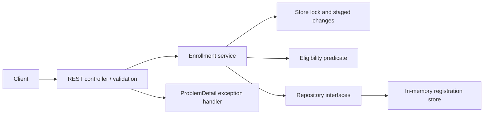

# Architecture: course waitlist

## Scope and dependencies

Java 21, Spring Boot 4.1.2, Maven Wrapper, Spring MVC, Jakarta Validation,
Springdoc OpenAPI 3.x, JUnit 6, Mockito and Cucumber 8.1.0 implement the
one-offering slice. The user requested removal of H2 to restore the assessment's
in-memory fallback. There is no database or external prerequisite service.

## Components



`api` maps HTTP/JSON and errors; `application` implements operations, result
types, and ports; `domain` contains the offering, registration, and lifecycle
rules; `infrastructure.memory` implements the store, offering repository and
eligibility fixture; `config` creates the
service and repositories. Tests include service, MVC, and Cucumber
packages. Controllers and clients must not write directly to repositories.

## Domain and relationships

An `Offering` has an opaque ID and non-negative fixed capacity. A
`Registration` relates that offering to an opaque learner ID and has status
`ENROLLED`, `WAITLISTED`, `DROPPED`, or `INELIGIBLE`. Only waitlisted entries
have a positive, monotonically increasing queue sequence. Registration IDs
follow the same identifier rules as the API. There is one offering and at
most one active registration per learner; the store retains only the
latest registration per learner. Re-registering after a terminal state replaces
that prior state and, if full, gets a new queue sequence. It is not an audit log.

The fixture policy evaluates prerequisites using an explicit set of eligible
IDs. It is not an identity directory, transcript, or configurable policy engine.
The caller cannot supply an eligibility assertion. Eligibility is checked on
initial registration and on promotion. A duplicate active request returns its
current state without changing its position or re-evaluating eligibility.

## In-memory storage

The configured offering is immutable. A store holds a map keyed by learner ID
and a waitlist sequence counter for that offering. Domain validation and the
store reject invalid registrations and duplicate or unallocated queue
sequences. Each operation runs under the store's monitor against a private
working copy; only a successful operation publishes the copy and counter.
An exception discards both. Nested store operations are rejected.

## API

Base: `/api/v1/offerings/{offeringId}`. IDs are nonblank, at most 100 UTF-16
code units, and must not have surrounding Unicode whitespace or space
characters. They are case-sensitive. `learnerId` in the request body must be
a JSON string; numbers and other JSON types are not coerced.

| Method and path | Outcome |
|---|---|
| `POST /registrations` | 201 for new enrollment/waitlist; 200 for an existing active registration |
| `GET /registrations/{learnerId}` | 200 for the latest registration, including terminal states; 404 if absent |
| `DELETE /enrollments/{learnerId}` | 200 and promotion result; 409 if learner is not enrolled |

Example request and new enrollment response (`201`):

```json
{"learnerId":"learner-1001"}
```

```json
{"offeringId":"CS101-FALL","learnerId":"learner-1001","status":"ENROLLED","waitlistPosition":null,"created":true}
```

When full, the response instead has `"status":"WAITLISTED"` and its current
one-based `waitlistPosition`. GET and repeated POST return `created: false`.
Position is calculated at read time and changes when earlier entries leave.

Example drop response (`200`):

```json
{"offeringId":"CS101-FALL","droppedLearnerId":"learner-1001","promotedLearnerId":"learner-1042","skippedIneligibleCount":1,"remainingCapacity":0}
```

`promotedLearnerId` is null if no eligible candidate remains. Responses are:

| Condition | Status | Outcome |
|---|---:|---|
| New eligible registration with a seat or a waitlist place | 201 | `ENROLLED` or `WAITLISTED` |
| Duplicate active registration | 200 | Existing registration, unchanged |
| Missing/malformed body, non-string learner ID, or invalid ID | 400 | Problem response |
| Unknown offering, registration, or route (including a missing path segment) | 404 | Problem response |
| Drop when learner is not enrolled, including repeated drops | 409 | Problem response, no state change |
| Unsatisfied prerequisite | 422 | Problem response, no registration |
| Unsupported HTTP method or content type | 405 or 415 | Problem response; applicable HTTP headers are preserved |
| Unexpected failure | 500 | Generic problem response; diagnostic details are logged server-side |

When the client accepts `application/problem+json`, errors have a stable type URN,
title, status, detail, and request instance. A client that rejects the problem
media type may instead receive a 406 without a problem body. Example:

```json
{"type":"urn:course-waitlist:ineligible","title":"Unprocessable Content","status":422,"detail":"Prerequisite is not satisfied","instance":"/api/v1/offerings/CS101-FALL/registrations"}
```

Server errors use type `urn:course-waitlist:internal-error` and detail
`An unexpected error occurred`; internal messages and stack traces are
not returned. Springdoc exposes local OpenAPI and Swagger UI; see the README.
OpenAPI response schemas, problem responses, identifier constraints and
nullable fields are explicitly documented and covered by a controller test.

## Workflows and invariants

**Register:** validate IDs, lock the store and create a working copy, return
an active existing registration, check the prerequisite, then enroll if count
is below capacity or add a new FIFO waitlist entry. Publish the copy after
the result is constructed. Capacity 0 is valid and always causes eligible learners
to waitlist.

**Drop:** validate and lock; require an enrolled learner. Scan the queue in
sequence order and recheck eligibility until the first eligible entry is found.
All eligibility evaluations happen before any mutations, so an evaluator
failure leaves all state unchanged. Mark the dropped registration `DROPPED`,
mark skipped entries `INELIGIBLE`, and promote at most the first eligible entry
to `ENROLLED`. If none is eligible, leave the seat available.

Each operation holds the shared store monitor, including reads that need a
consistent queue position. Checks and mutations therefore serialize across
service instances using that store. A failure discards staged changes, including
the sequence counter. This preserves enrollment count <= capacity, one current
registration per learner, FIFO order, and at most one promotion per released
seat. The synchronization applies only within the same process and store instance.

### Concurrency review

The register, drop, and registration lookup paths all acquire the same store
monitor before reading or changing registration state. The map key prevents
more than one stored record per learner. Under this protocol,
the focused tests found no capacity, duplication, promotion, or rollback
violations in the exercised interleavings.

FIFO means the order of successfully published waitlist sequence allocations,
not the order in which concurrent HTTP requests arrived or threads started.
Monitor acquisition fairness is not guaranteed. Tests coordinate starts and
selected lock ownership, verify the stored queue, and assert promotion in that
order. A contention test holds the monitor while staging a failed operation,
then verifies that a competing request succeeds with the original sequence.

These are bounded in-process tests, not exhaustive proofs. Separate application
processes have separate stores. The monitor serializes reads and writes, and
copying and scanning the store can delay requests as the waitlist grows.

## Security and operational boundaries

The prototype has no authentication or authorization and binds to localhost.
Do not expose it publicly. Production use requires independently designed
identity/authorization, transport security, durable shared state, and trusted
prerequisite data. Logs record operation outcomes without learner IDs or request
bodies; unexpected exceptions are logged for diagnosis. Do not include secrets or
unnecessary sensitive data in prompts or submitted AI records.

## Test approach and trade-offs

JUnit unit tests isolate enrollment decisions with mocked collaborators; separate
in-memory service tests exercise real repositories and use a Mockito eligibility
collaborator where changing behavior is needed. The concurrent tests coordinate
simultaneous registrations, duplicate drops, and distinct concurrent drops
through two service instances sharing the same store, and verify counts
and FIFO promotion. Tests also
exercise discarded staged changes and sequence allocations after failure.
MVC tests exercise HTTP, validation and serialization with a real
Spring application context; a separate test starts an actual local HTTP server.
Cucumber scenarios express the core business
behaviors using isolated in-memory stores. All run with Maven `test`.

The store monitor serializes operations for this offering. The fixture
cannot change at runtime, although tests use a mutable predicate to verify
promotion rechecking. A restart loses all state. There is no waitlist
cancellation, history, offering management, authentication, deployment, or
multi-process consistency; each process has its own store.
