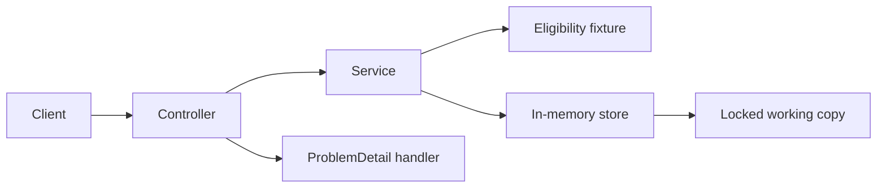

# Architecture summary

The controller handles HTTP and validation. The service owns eligibility,
capacity, duplicate and promotion rules. The store serializes operations using
one monitor and publishes a working map and sequence counter only after success.
Reads also use the monitor. The map retains one latest registration per learner.

This protects capacity and promotion invariants only for service instances
sharing the same store in one process. FIFO is successful sequence-allocation
order; simultaneous request arrival order and lock fairness are not guaranteed.
Data is not durable. See the detailed [architecture](../docs/architecture.md),
[API](../docs/api.md), and [data design](../docs/database-design.md).
